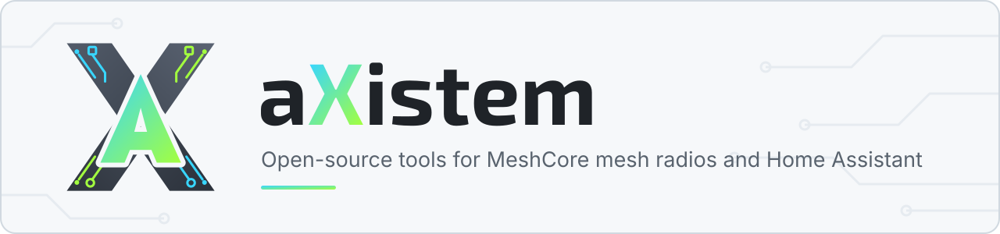
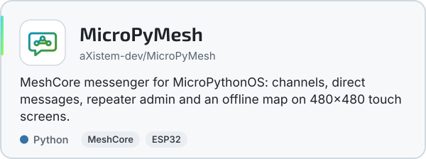
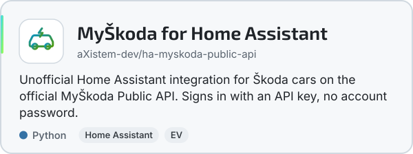
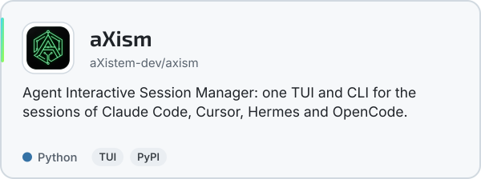
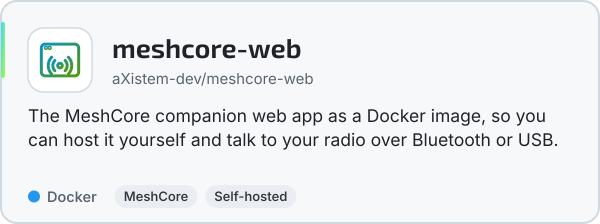
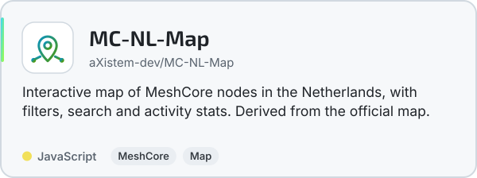

<picture>
  <source media="(prefers-color-scheme: dark)" srcset="https://raw.githubusercontent.com/aXistem-dev/.github/main/assets/banner-dark.svg">
  
</picture>

  

We build our own apps and integrations, and we work on patches in forks of the projects we use.

## Projects

<table>
<tr>
<td width="50%" valign="top">
<a href="https://github.com/aXistem-dev/MicroPyMesh"><picture>
  <source media="(prefers-color-scheme: dark)" srcset="https://raw.githubusercontent.com/aXistem-dev/.github/main/assets/cards/MicroPyMesh-dark.svg">
  
</picture></a>

</td>
<td width="50%" valign="top">
<a href="https://github.com/aXistem-dev/ha-myskoda-public-api"><picture>
  <source media="(prefers-color-scheme: dark)" srcset="https://raw.githubusercontent.com/aXistem-dev/.github/main/assets/cards/ha-myskoda-public-api-dark.svg">
  
</picture></a>

</td>
</tr>
<tr>
<td width="50%" valign="top">
<a href="https://github.com/aXistem-dev/axism"><picture>
  <source media="(prefers-color-scheme: dark)" srcset="https://raw.githubusercontent.com/aXistem-dev/.github/main/assets/cards/axism-dark.svg">
  
</picture></a>

</td>
<td width="50%" valign="top">
<a href="https://github.com/aXistem-dev/meshcore-web"><picture>
  <source media="(prefers-color-scheme: dark)" srcset="https://raw.githubusercontent.com/aXistem-dev/.github/main/assets/cards/meshcore-web-dark.svg">
  
</picture></a>

</td>
</tr>
<tr>
<td colspan="2" align="center">
<a href="https://github.com/aXistem-dev/MC-NL-Map"><picture>
  <source media="(prefers-color-scheme: dark)" srcset="https://raw.githubusercontent.com/aXistem-dev/.github/main/assets/cards/MC-NL-Map-dark.svg">
  
</picture></a>

</td>
</tr>
</table>

## Forks we work on

Patches start on a branch in our fork and are offered upstream as pull requests when they are ready.

| | Fork | Upstream | Project |
|:-:|---|---|---|
| 📡 | [MeshCore](https://github.com/aXistem-dev/MeshCore) | [meshcore-dev/MeshCore](https://github.com/meshcore-dev/MeshCore)    | Lightweight hybrid-routing mesh firmware for LoRa radios |
| 🖐️ | [wadamesh](https://github.com/aXistem-dev/wadamesh) | [ALLFATHER-BV/wadamesh](https://github.com/ALLFATHER-BV/wadamesh)    | Touch-UI MeshCore firmware; our SenseCAP Indicator port is merged upstream |
| 📱 | [MicroPythonOS](https://github.com/aXistem-dev/MicroPythonOS) | [MicroPythonOS/MicroPythonOS](https://github.com/MicroPythonOS/MicroPythonOS)    | An Android-like operating system for ESP32 boards |
| ✈️ | [Cardputer-ADV-B-Radar](https://github.com/aXistem-dev/Cardputer-ADV-B-Radar) | [Jay-Jayismyname1/Cardputer-ADV-B-Radar](https://github.com/Jay-Jayismyname1/Cardputer-ADV-B-Radar)    | ADS-B flight tracking for the M5Stack Cardputer ADV |
| 🍼 | [babybuddy](https://github.com/aXistem-dev/babybuddy) · [babybuddyios](https://github.com/aXistem-dev/babybuddyios) | [babybuddy/babybuddy](https://github.com/babybuddy/babybuddy) · [kguy18/babybuddyios](https://github.com/kguy18/babybuddyios)    | Baby Buddy, the caregiver tracker, and its iOS app |
| 🕒 | [ha-awtrix](https://github.com/aXistem-dev/ha-awtrix) | [miguelangellv/ha-awtrix](https://github.com/miguelangellv/ha-awtrix)    | Home Assistant integration for AWTRIX LED matrix clocks |
| 🏠 | [meshcore-card](https://github.com/aXistem-dev/meshcore-card) · [ha-samsung-washing-card](https://github.com/aXistem-dev/ha-samsung-washing-card) | [dida886/meshcore-card](https://github.com/dida886/meshcore-card) · [cryptooth/ha-samsung-washing-card](https://github.com/cryptooth/ha-samsung-washing-card)    | Home Assistant dashboard cards |

 

 
aXistem

